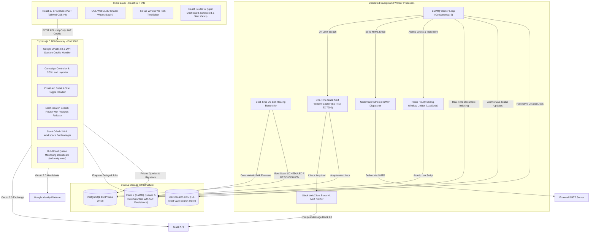
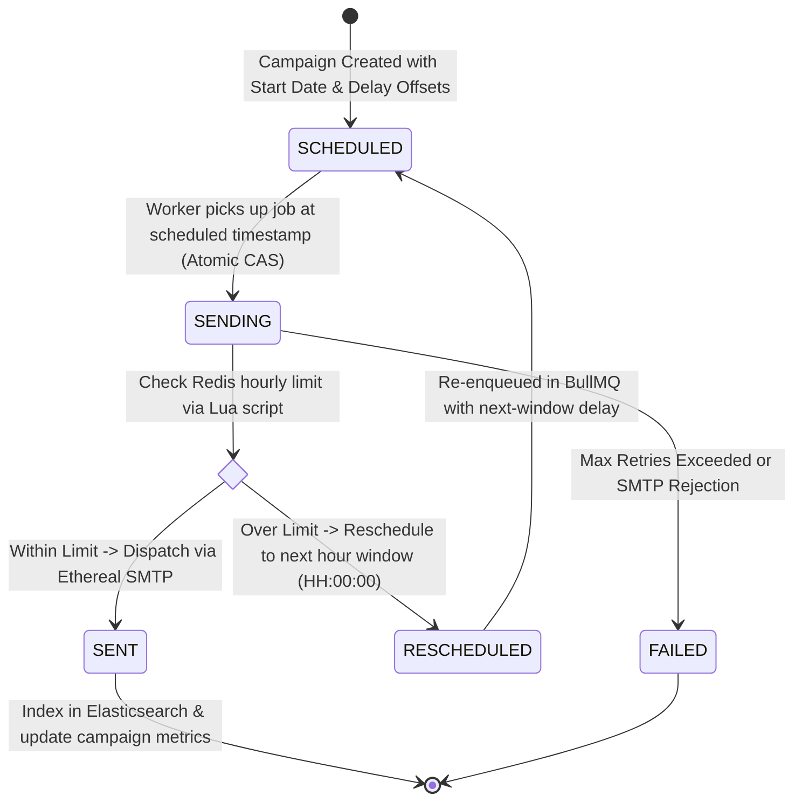
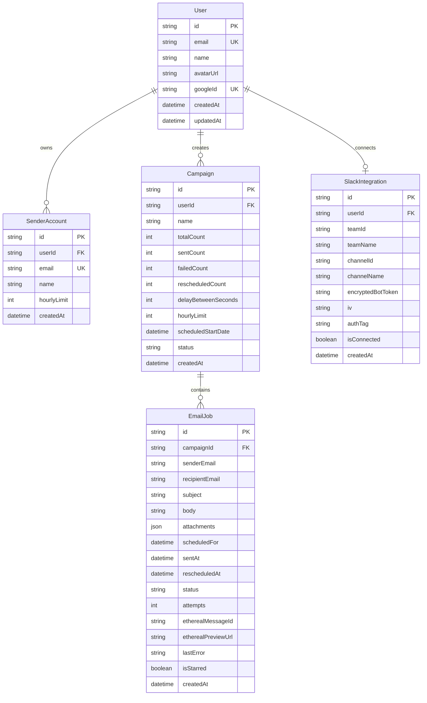

# ReachInbox Architecture & Engineering Specification

This document details the system architecture, queue mechanics, data models, rate-limiting design, restart-recovery reconciliation, security patterns, and search engine fallback implemented in **ReachInbox**.

---

## 1. System Architecture & High-Level Topology

ReachInbox is built with a decoupled three-tier architecture connecting an interactive Single-Page Application, an Express.js API gateway, dedicated background worker processes, and containerized state stores:



---

## 2. Queue Lifecycle & Finite State Machine

Every outbound email is modeled as an `EmailJob` in PostgreSQL and tracked as a delayed job in BullMQ.



### Atomic Compare-and-Set (CAS) Execution
To guarantee **exactly-once execution** in multi-worker environments, the worker claims jobs atomically before touching any network resource:

```typescript
const transition = await prisma.emailJob.updateMany({
  where: {
    id: emailJobId,
    status: { in: [EmailJobStatus.SCHEDULED, EmailJobStatus.RESCHEDULED] },
  },
  data: {
    status: EmailJobStatus.SENDING,
    attempts: { increment: 1 },
  },
});

if (transition.count === 0) {
  // Another concurrent thread or worker has already claimed this job. Skip cleanly.
  return;
}
```

---

## 3. Distributed Hour-Aligned Rate Limiting & Next-Window Rescheduling

### The Sliding Window Challenge
Traditional fixed-window limiters suffer from edge-burst vulnerabilities (e.g., sending 20 emails at 7:59 PM and another 20 at 8:01 PM). Furthermore, if a limit is breached, jobs must **never be discarded**; they must safely defer to the next hour boundary without user intervention.

### Rate Limiter Implementation
1. **Hour-Aligned Keying**:
   - Redis key format: `ratelimit:sender:{senderEmail}:{YYYY-MM-DD-HH}` (UTC-aligned).
2. **Atomic Lua Script**:
   - Executes atomic check-and-increment:
     ```lua
     local current = redis.call('GET', KEYS[1])
     if current and tonumber(current) >= tonumber(ARGV[1]) then
         return {0, tonumber(current)}
     end
     local val = redis.call('INCR', KEYS[1])
     if val == 1 then
         redis.call('EXPIRE', KEYS[1], ARGV[2])
     end
     return {1, val}
     ```
3. **Next-Window Calculation**:
   - If `allowed === 0`, calculates exact timestamp of the upcoming hour boundary (`00:00:000`).
   - Updates `EmailJob` status in PostgreSQL to `RESCHEDULED` with `scheduledFor = nextWindowTime`.
   - Re-enqueues in BullMQ with `delay = nextWindowTime - Date.now()`.
4. **Single-Alert Lock per Window**:
   - To prevent spamming Slack with 50+ notifications for every rate-limited email in a batch, the worker acquires a Redis mutex:
     ```typescript
     const lockKey = `alertlock:ratelimit:${senderEmail}:${windowKey}`;
     const acquired = await redis.set(lockKey, '1', 'EX', 7200, 'NX');
     ```
   - Exactly **one** comprehensive Slack Block Kit alert is dispatched per hourly window per sender, displaying:
     - Sender email address
     - Configured hourly limit
     - Sent count (`20 / 20`)
     - Number of pending/rescheduled emails waiting in queue
     - Next resumption timestamp (`08:00:00 PM GMT+5:30`)

---

## 4. Zero-Loss Worker Restart Resilience & Self-Healing

When worker processes crash, reboot, or are redeployed:

1. **Redis AOF (Append-Only File) Persistence**:
   - Redis runs with `--appendonly yes`, ensuring scheduled timers in the BullMQ delayed sorted set (`bull:email-queue:delayed`) are flushed to disk.
2. **Deterministic BullMQ Job IDs**:
   - Every job is keyed as `jobId: emailJob-${job.id}`. If an enqueue command runs multiple times, BullMQ deduplicates automatically.
3. **Boot-Time Self-Healing Reconciler**:
   - When the worker boots, `reconcileScheduledJobs()` scans PostgreSQL for any jobs in `SCHEDULED` or `RESCHEDULED` status:
     ```typescript
     const pendingJobs = await prisma.emailJob.findMany({
       where: { status: { in: [EmailJobStatus.SCHEDULED, EmailJobStatus.RESCHEDULED] } },
     });

     const bulkJobs = pendingJobs.map(job => ({
       name: 'send-email',
       data: { ... },
       opts: {
         jobId: `emailJob-${job.id}`,
         delay: Math.max(0, new Date(job.scheduledFor).getTime() - Date.now()),
       },
     }));

     await emailQueue.addBulk(bulkJobs);
     ```
   - If a job was already registered in Redis &rarr; Ignored (no duplicates).
   - If Redis lost state or the worker was offline past the scheduled send time &rarr; Enqueued with `delay: 0` for immediate dispatch.

---

## 5. Database Schema & Entity Relationships



---

## 6. Elasticsearch Search Engine with Automatic Database Fallback

- **Elasticsearch 8.15 Cluster**:
  - Index: `reachinbox_emails`
  - Mapping: Analyzed multi-field text for `subject`, `body`, and keyword fields for `recipientEmail`, `senderEmail`, `status`, `userId`.
  - Query: Multi-match across `recipientEmail^3`, `subject^2`, `body` with `fuzziness: "AUTO"`.
- **Database Fallback Resilience**:
  - If Elasticsearch encounters connection timeouts, network partitions, or is stopped for maintenance, `searchEmails()` seamlessly intercepts the error and executes an indexed case-insensitive `ILIKE` query in PostgreSQL via Prisma:
    ```typescript
    return {
      source: 'database_fallback',
      items: postgresResults,
      total: postgresResults.length,
    };
    ```
  - **Zero disruption**: The dashboard transparently displays results and indicates the fallback source without throwing errors to the user.

---

## 7. Security & Cryptographic Controls

| Domain | Implementation | Security Objective |
| :--- | :--- | :--- |
| **Session Transport** | Signed JWT stored in `httpOnly`, `SameSite=Lax`, `Secure` cookies | Complete immunity to JavaScript token theft via Cross-Site Scripting (XSS). |
| **Token Storage** | AES-256-GCM symmetric encryption with 12-byte IV and 16-byte authentication tag | Slack OAuth bot tokens are never stored as plaintext in PostgreSQL. |
| **Input Validation** | Strict `zod` schemas on every API payload | Prevents type coercion attacks, malformed payloads, and injection attempts. |
| **Log Sanitization** | `pino` structured logger with key redaction | Prevents JWTs, session tokens, passwords, and API secrets from leaking into log files. |
| **Rate Limiting (API)** | `express-rate-limit` on authentication routes | Mitigates brute-force authentication and spam requests. |
